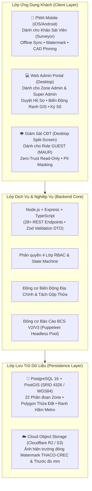

# 🚇 HỆ THỐNG KHẢO SÁT HIỆN TRẠNG & ĐÁNH GIÁ RỦI RO CÔNG TRÌNH METRO 2
## (BUILDING CONDITION SURVEY & RISK ASSESSMENT PLATFORM - BCS METRO 2)

> **Dự án:** Tuyến Tàu điện ngầm Số 2 TP.HCM (Bến Thành – Tham Lương)  
> **Chủ đầu tư / Cơ quan quản lý:** Ban Quản lý Đường sắt Đô thị TP.HCM (MAUR)  
> **Tiêu chuẩn Báo cáo & Giám sát:** Liên danh Tư vấn CRLG – CRSRI – TT & Nhà thầu EPC THACO – CREC  
> **Tính chất dữ liệu:** Dữ liệu khảo sát hiện trạng nứt lún, nghiêng võng là **căn cứ pháp lý duy nhất** để đối chiếu, bồi thường hoặc khước từ bồi thường khi thi công máy khoan hầm TBM đi qua khu dân cư.

---

## ⚡ 1. KHỞI CHẠY HỆ THỐNG LOCAL (1 DÒNG LỆNH DUY NHẤT)

Mở **Terminal** tại thư mục dự án và dán dòng lệnh sau:

```bash
./start-local.sh
```

*(Hoặc dùng lệnh npm tương đương):*
```bash
npm start
```

### 🛠️ Script này tự động xử lý toàn diện:
1. **Docker Container PostGIS**: Tự động bật container PostgreSQL 16 + PostGIS (`metro2_postgres_postgis`) trên cổng **5433** và chờ kiểm tra trạng thái `healthy`.
2. **Cài đặt thư viện**: Tự động phát hiện và chạy `npm install` cho cả Backend và Frontend nếu thiếu.
3. **Giải phóng cổng mạng (Port Conflict Auto-resolve)**: Tự động dọn dẹp các tiến trình cũ nếu cổng **4000** (Backend) hoặc **3000** (Frontend) bị chiếm dụng.
4. **Khởi chạy đồng thời**:
   - Backend API: `http://localhost:4000/api/v1`
   - Frontend PWA: `http://localhost:3000`
5. **Tự động mở trình duyệt**: Tự mở trang chủ trên trình duyệt Safari/Chrome.

### 🌐 Danh Sách Đường Dẫn Dịch Vụ:
| Thành phần | Giao thức / Port | Đường dẫn kiểm tra |
| :--- | :--- | :--- |
| **Giao diện Khảo sát (Frontend PWA)** | HTTP : 3000 | [`http://localhost:3000`](http://localhost:3000) |
| **Dịch vụ API (Backend Service)** | HTTP : 4000 | [`http://localhost:4000/api/v1`](http://localhost:4000/api/v1) |
| **Kiểm tra trạng thái (Health Check)** | HTTP : 4000 | [`http://localhost:4000/health`](http://localhost:4000/health) |
| **CSDL Không gian PostGIS** | TCP : 5433 | `localhost:5433` (DB: `metro2_gis_db`, User: `metro2_user`) |

### 🔑 Tài Khoản Đăng Nhập Mẫu (Đã Phân Quyền Sẵn):
| Vai trò | Tên đăng nhập (`username`) | Mật khẩu (`password`) | Phạm vi quyền hạn |
| :--- | :--- | :--- | :--- |
| **Super Admin** | `superadmin` | `Admin@123` | Quản trị toàn tuyến Metro 2, phân bổ Zone, duyệt báo cáo đặc biệt |
| **Zone Admin** | `zoneadmin_s9` | `Admin@123` | Quản lý Ga S9 (Bà Quẹo), duyệt hồ sơ khảo sát, ký số xác nhận, quản lý biến động ranh GIS |
| **Surveyor** | `surveyor_s9_01` | `Password@123` | Kỹ sư hiện trường: điểm danh GPS, chụp ảnh watermark, gắn khuyết tật CAD |
| **Surveyor 2** | `surveyor_s9_02` | `Password@123` | Khảo sát viên phụ thuộc Ga S9 |
| **Contractor Guest** | `contractor_guest` | `Password@123` | Chủ đầu tư / Nhà thầu tra cứu rủi ro (Chỉ đọc, che mờ thông tin cá nhân) |

*Chi tiết về hướng dẫn chạy local, reset CSDL và xử lý sự cố xem tại: [`docs/06_operations/local_development_guide.md`](file:///Users/vqd2k6/Desktop/MIT-techology/KSat_QHoach/docs/06_operations/local_development_guide.md).*

---

## 🏛️ 2. TỔNG QUAN KIẾN TRÚC HỆ THỐNG (SYSTEM ARCHITECTURE)

Hệ thống được thiết kế theo mô hình **Micro-monorepo Module hóa (Modular Monorepo)**:



### 3 Trụ Cột Nghiệp Vụ Nền Tảng:
1. **Mô hình Thực thể Hướng đối tượng Cha - Con (Parent-Child Hierarchy)**:
   - **Tòa nhà Mẹ (`BuildingMaster`)**: Quản lý khối tháp, ranh thửa PostGIS, độ nghiêng tổng thể, kết cấu móng, tầng hầm và hồ sơ hoàn công dùng chung.
   - **Căn hộ Con (`BuildingUnit`)**: Kế thừa 100% dữ liệu móng/nghiêng từ tòa mẹ; chỉ tập trung khảo sát sở hữu riêng trong 5–8 phút/căn (bộ 4 ảnh tinh gọn P01–P04, ghim nứt nội thất).
2. **Kiến trúc Chống Rơi Rụng Thông Tin (Zero-Data-Drop Engine)**:
   - Đồng bộ toàn trình qua 7 chốt chặn: `Form UI -> Zustand Store -> Network Payload -> Zod DTO Schema -> SQL Repository -> Handlebars Template -> PDF`.
   - Kết xuất Báo cáo Kỹ thuật V2/V3 chuẩn Liên danh CRLG – CRSRI – TT (9 Chương La Mã, 4 Phụ lục, in ấn A4 CSS Paged Media 300 DPI).
3. **Bảo toàn Pháp lý & Bất biến Dữ liệu (Data Immutability)**:
   - Chặn 100% API chỉnh sửa sau khi hồ sơ đạt trạng thái `APPROVED`.
   - Tự động sinh mã băm SHA-256 trên nội dung hồ sơ và chữ ký 3 bên để bảo chứng pháp lý trước Tòa án.

---

## 📚 3. CỔNG TRA CỨU TÀI LIỆU KỸ THUẬT (DOCUMENTATION INDEX)

Toàn bộ tài liệu kỹ thuật của dự án được quy tụ chuẩn mực trong thư mục [`docs/`](file:///Users/vqd2k6/Desktop/MIT-techology/KSat_QHoach/docs/README.md) gồm 7 phân khu chức năng:

| Thư mục | Tên phân khu | Nội dung cốt lõi | Tài liệu nổi bật |
|:---:|:---|:---|:---|
| [`01_architecture/`](file:///Users/vqd2k6/Desktop/MIT-techology/KSat_QHoach/docs/01_architecture/) | **Kiến trúc CSDL & Luồng** | Mô hình Lớp OOP, 21 bảng CSDL PostGIS, kiến trúc Mã kép Dual-ID, sơ đồ tuần tự | [`class_diagram_and_db_schema.md`](file:///Users/vqd2k6/Desktop/MIT-techology/KSat_QHoach/docs/01_architecture/class_diagram_and_db_schema.md)<br/>[`business_logic_and_dual_id.md`](file:///Users/vqd2k6/Desktop/MIT-techology/KSat_QHoach/docs/01_architecture/business_logic_and_dual_id.md) |
| [`02_api/`](file:///Users/vqd2k6/Desktop/MIT-techology/KSat_QHoach/docs/02_api/) | **Giao diện API** | 28+ REST endpoints, JSON Schema, chuẩn lỗi RFC 7807, file OpenAPI 3.1.0 | [`api_specification.md`](file:///Users/vqd2k6/Desktop/MIT-techology/KSat_QHoach/docs/02_api/api_specification.md)<br/>[`openapi.yaml`](file:///Users/vqd2k6/Desktop/MIT-techology/KSat_QHoach/docs/02_api/openapi.yaml) |
| [`03_standards/`](file:///Users/vqd2k6/Desktop/MIT-techology/KSat_QHoach/docs/03_standards/) | **Quy chuẩn Bắt buộc** | Bảng danh mục 22 Zone, quy chuẩn mã tầng/căn hộ TCVN, cú pháp mã ảnh & watermark | [`db_gis_and_spatial_standard.md`](file:///Users/vqd2k6/Desktop/MIT-techology/KSat_QHoach/docs/03_standards/db_gis_and_spatial_standard.md)<br/>[`floor_and_unit_coding_standard.md`](file:///Users/vqd2k6/Desktop/MIT-techology/KSat_QHoach/docs/03_standards/floor_and_unit_coding_standard.md)<br/>[`photo_and_watermark_standard.md`](file:///Users/vqd2k6/Desktop/MIT-techology/KSat_QHoach/docs/03_standards/photo_and_watermark_standard.md) |
| [`04_modules/`](file:///Users/vqd2k6/Desktop/MIT-techology/KSat_QHoach/docs/04_modules/) | **Đặc tả Phân hệ** | Kiến trúc Khảo sát Chung cư, Động cơ Báo cáo V2/V3, Role Guest, Quản trị Zone Admin, Đồng bộ ca | [`condominium/README.md`](file:///Users/vqd2k6/Desktop/MIT-techology/KSat_QHoach/docs/04_modules/condominium/README.md)<br/>[`report_engine/architecture_blueprint.md`](file:///Users/vqd2k6/Desktop/MIT-techology/KSat_QHoach/docs/04_modules/report_engine/architecture_blueprint.md)<br/>[`guest_role/guest_role_specification.md`](file:///Users/vqd2k6/Desktop/MIT-techology/KSat_QHoach/docs/04_modules/guest_role/guest_role_specification.md)<br/>[`zone_admin/roadmap_and_task_tracker.md`](file:///Users/vqd2k6/Desktop/MIT-techology/KSat_QHoach/docs/04_modules/zone_admin/roadmap_and_task_tracker.md) |
| [`05_requirements/`](file:///Users/vqd2k6/Desktop/MIT-techology/KSat_QHoach/docs/05_requirements/) | **Yêu cầu & Biểu mẫu** | PRD sản phẩm, Kế hoạch ban đầu, biểu mẫu Phase 1 & 2, file Word gốc của Ban QLDA MAUR | [`project_prd.md`](file:///Users/vqd2k6/Desktop/MIT-techology/KSat_QHoach/docs/05_requirements/project_prd.md)<br/>[`implementation_plan.md`](file:///Users/vqd2k6/Desktop/MIT-techology/KSat_QHoach/docs/05_requirements/implementation_plan.md)<br/>[`client_templates/`](file:///Users/vqd2k6/Desktop/MIT-techology/KSat_QHoach/docs/05_requirements/client_templates/) |
| [`06_operations/`](file:///Users/vqd2k6/Desktop/MIT-techology/KSat_QHoach/docs/06_operations/) | **Vận hành & DevOps** | Sổ tay chạy local, thiết kế hạ tầng Docker Compose, sổ tay di chuyển CSDL an toàn | [`local_development_guide.md`](file:///Users/vqd2k6/Desktop/MIT-techology/KSat_QHoach/docs/06_operations/local_development_guide.md)<br/>[`deployment_guide.md`](file:///Users/vqd2k6/Desktop/MIT-techology/KSat_QHoach/docs/06_operations/deployment_guide.md)<br/>[`migrations/20261001_multi_photo_defect_d.md`](file:///Users/vqd2k6/Desktop/MIT-techology/KSat_QHoach/docs/06_operations/migrations/20261001_multi_photo_defect_d.md) |
| [`07_archive/`](file:///Users/vqd2k6/Desktop/MIT-techology/KSat_QHoach/docs/07_archive/) | **Lưu trữ Lịch sử** | Bản thảo và tài liệu các phiên bản cũ đã được thay thế (bảo tồn vết lịch sử) | [`07_archive/README.md`](file:///Users/vqd2k6/Desktop/MIT-techology/KSat_QHoach/docs/07_archive/README.md) |

👉 **Xem hướng dẫn chi tiết và bản đồ tra cứu toàn diện tại: [`docs/README.md`](file:///Users/vqd2k6/Desktop/MIT-techology/KSat_QHoach/docs/README.md)**

---

## 🛡️ 4. BỘ QUY CHUẨN KỸ THUẬT & CHỐNG LỖI CỦA HỆ THỐNG
Mọi lập trình viên và Agent AI khi tham gia phát triển codebase bắt buộc phải tuân thủ nghiêm ngặt 3 tài liệu quy tắc trong `.agents/rules/`:
1. [Quy Chuẩn Kiến Trúc & 6 Lỗi Hệ Thống Nền Tảng](file:///Users/vqd2k6/Desktop/MIT-techology/KSat_QHoach/.agents/rules/architectural_standards_and_system_rules.md)
2. [Hệ Thống Quy Trình Toàn Trình (5 Core Workflows)](file:///Users/vqd2k6/Desktop/MIT-techology/KSat_QHoach/.agents/rules/system_workflows.md)
3. [Giao Thức Điều Tra Sự Cố & Debugging Hệ Thống](file:///Users/vqd2k6/Desktop/MIT-techology/KSat_QHoach/.agents/rules/systematic_debugging_and_incident_protocol.md)

### Bộ Lệnh Kiểm Tra Chất Lượng Tự Động:
```bash
# Kiểm tra kỷ luật Zero Any TypeScript (Total count = 0)
cd frontend && npm run check:zero-any

# Kiểm tra kỷ luật Try-Catch minh bạch (Không nuốt lỗi âm thầm)
cd frontend && npm run check:catch

# Kiểm tra tương tác UI (100% button/onClick có class cursor-pointer)
cd frontend && npm run check:ui

# Kiểm tra biên dịch sản phẩm sạch
cd backend && npm run build
cd frontend && npm run build
```
