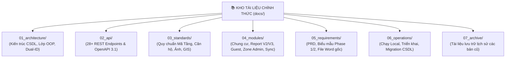

# 📚 KHO TÀI LIỆU KỸ THUẬT NỀN TẢNG (METRO 2 BCS DOCUMENTATION HUB)

> **Hệ thống:** Khảo sát Hiện trạng & Đánh giá Rủi ro Công trình Tuyến Metro Số 2 TP.HCM (Bến Thành – Tham Lương)  
> **Chủ đầu tư / Cơ quan quản lý:** Ban Quản lý Đường sắt Đô thị TP.HCM (MAUR)  
> **Tiêu chuẩn áp dụng:** Liên danh CRLG – CRSRI – TT & Nhà thầu EPC THACO – CREC  
> **Mục tiêu:** Cung cấp đầu mối tra cứu duy nhất (Single Source of Truth), phân cấp khoa học 7 nhóm tài liệu từ kiến trúc nền tảng, chuẩn API, quy chuẩn mã hóa, đặc tả các phân hệ nghiệp vụ đến sổ tay vận hành.

---

## 🧭 SƠ ĐỒ ĐỊNH HƯỚNG TỔNG QUAN (DOCUMENTATION TAXONOMY)

---

## 👥 HƯỚNG DẪN TRA CỨU THEO VAI TRÒ (ONBOARDING BY ROLE)

| Vai trò của bạn | Điểm bắt đầu khuyến nghị | Các tài liệu cần đọc sâu |
|:---|:---|:---|
| **Kỹ sư Backend (Node.js/Express/PostgreSQL)** | [`01_architecture/class_diagram_and_db_schema.md`](file:///Users/vqd2k6/Desktop/MIT-techology/KSat_QHoach/docs/01_architecture/class_diagram_and_db_schema.md) | 1. [`02_api/api_specification.md`](file:///Users/vqd2k6/Desktop/MIT-techology/KSat_QHoach/docs/02_api/api_specification.md) 2. [`01_architecture/business_logic_and_dual_id.md`](file:///Users/vqd2k6/Desktop/MIT-techology/KSat_QHoach/docs/01_architecture/business_logic_and_dual_id.md) 3. [`04_modules/condominium/04_database_and_state_machine.md`](file:///Users/vqd2k6/Desktop/MIT-techology/KSat_QHoach/docs/04_modules/condominium/04_database_and_state_machine.md) 4. [Quy chuẩn 6 Lỗi Hệ Thống](file:///Users/vqd2k6/Desktop/MIT-techology/KSat_QHoach/.agents/rules/architectural_standards_and_system_rules.md) |
| **Kỹ sư Frontend (React/Vite/Zustand/PWA)** | [`04_modules/condominium/01_e2e_user_journey.md`](file:///Users/vqd2k6/Desktop/MIT-techology/KSat_QHoach/docs/04_modules/condominium/01_e2e_user_journey.md) | 1. [`03_standards/photo_and_watermark_standard.md`](file:///Users/vqd2k6/Desktop/MIT-techology/KSat_QHoach/docs/03_standards/photo_and_watermark_standard.md) 2. [`03_standards/floor_and_unit_coding_standard.md`](file:///Users/vqd2k6/Desktop/MIT-techology/KSat_QHoach/docs/03_standards/floor_and_unit_coding_standard.md) 3. [`04_modules/survey_sync/server_draft_sync_and_shift_handover.md`](file:///Users/vqd2k6/Desktop/MIT-techology/KSat_QHoach/docs/04_modules/survey_sync/server_draft_sync_and_shift_handover.md) 4. [Quy trình Đồng bộ E2E 7 Chốt](file:///Users/vqd2k6/Desktop/MIT-techology/KSat_QHoach/.agents/rules/system_workflows.md) |
| **Kỹ sư GIS & Không Gian Địa Lý** | [`03_standards/db_gis_and_spatial_standard.md`](file:///Users/vqd2k6/Desktop/MIT-techology/KSat_QHoach/docs/03_standards/db_gis_and_spatial_standard.md) | 1. [`01_architecture/gis_layer_specification.md`](file:///Users/vqd2k6/Desktop/MIT-techology/KSat_QHoach/docs/01_architecture/gis_layer_specification.md) 2. [`04_modules/zone_admin/roadmap_and_task_tracker.md`](file:///Users/vqd2k6/Desktop/MIT-techology/KSat_QHoach/docs/04_modules/zone_admin/roadmap_and_task_tracker.md) (Tách/Gộp/Hoán đổi thửa) 3. [Báo cáo Dữ liệu KS003 SQHKT](file:///Users/vqd2k6/Desktop/MIT-techology/KSat_QHoach/data/KS003/README_BAO_CAO_KS003.md) |
| **Kỹ sư Report & QA/QC** | [`04_modules/report_engine/architecture_blueprint.md`](file:///Users/vqd2k6/Desktop/MIT-techology/KSat_QHoach/docs/04_modules/report_engine/architecture_blueprint.md) | 1. [`04_modules/report_engine/field_dictionary_and_mapping.md`](file:///Users/vqd2k6/Desktop/MIT-techology/KSat_QHoach/docs/04_modules/report_engine/field_dictionary_and_mapping.md) 2. [`04_modules/report_engine/feedback_and_enhancements.md`](file:///Users/vqd2k6/Desktop/MIT-techology/KSat_QHoach/docs/04_modules/report_engine/feedback_and_enhancements.md) 3. [`04_modules/report_engine/handover_acceptance/06_acceptance_checklist.md`](file:///Users/vqd2k6/Desktop/MIT-techology/KSat_QHoach/docs/04_modules/report_engine/handover_acceptance/06_acceptance_checklist.md) |
| **Zone Admin & Tổ Trưởng Hiện Trường** | [`04_modules/zone_admin/roadmap_and_task_tracker.md`](file:///Users/vqd2k6/Desktop/MIT-techology/KSat_QHoach/docs/04_modules/zone_admin/roadmap_and_task_tracker.md) | 1. [`04_modules/survey_sync/server_draft_sync_and_shift_handover.md`](file:///Users/vqd2k6/Desktop/MIT-techology/KSat_QHoach/docs/04_modules/survey_sync/server_draft_sync_and_shift_handover.md) 2. [`03_standards/db_gis_and_spatial_standard.md`](file:///Users/vqd2k6/Desktop/MIT-techology/KSat_QHoach/docs/03_standards/db_gis_and_spatial_standard.md) |
| **Chủ Đầu Tư MAUR / Giám Sát CĐT (Guest)** | [`04_modules/guest_role/guest_role_specification.md`](file:///Users/vqd2k6/Desktop/MIT-techology/KSat_QHoach/docs/04_modules/guest_role/guest_role_specification.md) | 1. [`05_requirements/project_prd.md`](file:///Users/vqd2k6/Desktop/MIT-techology/KSat_QHoach/docs/05_requirements/project_prd.md) 2. [`05_requirements/client_templates/`](file:///Users/vqd2k6/Desktop/MIT-techology/KSat_QHoach/docs/05_requirements/client_templates/) |

---

## 🗂️ MỤC LỤC CHI TIẾT TOÀN BỘ 7 PHÂN KHU TÀI LIỆU

### 1. Phân khu 01: Kiến trúc Hệ thống & CSDL (`01_architecture/`)
Lớp kiến trúc nền tảng định nghĩa mô hình dữ liệu quan hệ, thực thể không gian và các luồng tương tác:
* [`class_diagram_and_db_schema.md`](file:///Users/vqd2k6/Desktop/MIT-techology/KSat_QHoach/docs/01_architecture/class_diagram_and_db_schema.md) `[ACTIVE]`: Mô hình Lớp OOP, 21 bảng CSDL PostgreSQL/PostGIS, Enums và ràng buộc toàn vẹn.
* [`business_logic_and_dual_id.md`](file:///Users/vqd2k6/Desktop/MIT-techology/KSat_QHoach/docs/01_architecture/business_logic_and_dual_id.md) `[ACTIVE]`: Kiến trúc Mã kép (Dual-ID: Địa chính vs Quản trị dự án) và ranh giới Transaction ACID.
* [`sequence_diagrams.md`](file:///Users/vqd2k6/Desktop/MIT-techology/KSat_QHoach/docs/01_architecture/sequence_diagrams.md) `[SPEC]`: Sơ đồ tương tác tuần tự giữa các Actor, API Service và CSDL.
* [`activity_diagrams.md`](file:///Users/vqd2k6/Desktop/MIT-techology/KSat_QHoach/docs/01_architecture/activity_diagrams.md) `[SPEC]`: Sơ đồ luồng hoạt động phân nhánh theo 4 vai trò người dùng.
* [`gis_layer_specification.md`](file:///Users/vqd2k6/Desktop/MIT-techology/KSat_QHoach/docs/01_architecture/gis_layer_specification.md) `[SPEC]`: Đặc tả cấu trúc các lớp bản đồ GIS, buffer vùng ảnh hưởng khiên đào TBM (ZOI).
* [`diagrams/phase1_docx_vs_srs_mapping.drawio`](file:///Users/vqd2k6/Desktop/MIT-techology/KSat_QHoach/docs/01_architecture/diagrams/phase1_docx_vs_srs_mapping.drawio): Sơ đồ trực quan ánh xạ giữa form Word và hệ thống SRS.

### 2. Phân khu 02: Hợp đồng Giao tiếp & API Contract (`02_api/`)
Đặc tả chi tiết toàn bộ các REST endpoints kết nối giữa Frontend PWA, Web Admin và Backend:
* [`api_specification.md`](file:///Users/vqd2k6/Desktop/MIT-techology/KSat_QHoach/docs/02_api/api_specification.md) `[ACTIVE]`: Toàn bộ 28+ RESTful Endpoints, JSON Schemas, định dạng lỗi chuẩn RFC 7807, ma trận phân quyền 4 cấp.
* [`openapi.yaml`](file:///Users/vqd2k6/Desktop/MIT-techology/KSat_QHoach/docs/02_api/openapi.yaml) `[ACTIVE]`: File hợp đồng OpenAPI 3.1.0 chuẩn hóa sẵn sàng import vào Swagger UI hoặc Postman.

### 3. Phân khu 03: Quy chuẩn Kỹ thuật Toàn dự án (`03_standards/`)
Các quy tắc chuẩn hóa mã số, quy chuẩn định danh và watermark có giá trị pháp lý bắt buộc:
* [`db_gis_and_spatial_standard.md`](file:///Users/vqd2k6/Desktop/MIT-techology/KSat_QHoach/docs/03_standards/db_gis_and_spatial_standard.md) `[STANDARD]`: Danh mục 22 Zone phân đoạn toàn tuyến Metro 2, PostGIS EPSG:4326 và cú pháp mã `B-XXXXX-YYY`.
* [`floor_and_unit_coding_standard.md`](file:///Users/vqd2k6/Desktop/MIT-techology/KSat_QHoach/docs/03_standards/floor_and_unit_coding_standard.md) `[STANDARD]`: Quy chuẩn mã tầng thực tế (`B01, G, MEZZ, F01...`), mã căn hộ (`P.402`) và mã khu vực dùng chung (`TB01.01`).
* [`photo_and_watermark_standard.md`](file:///Users/vqd2k6/Desktop/MIT-techology/KSat_QHoach/docs/03_standards/photo_and_watermark_standard.md) `[STANDARD]`: Cú pháp mã ảnh chuẩn hóa `HCM_M2.[MÃ_CT]_[TẦNG]_[VÙNG]_[MÃ_NỨT]_[LOẠI]_[STT]` và quy chuẩn đóng watermark logo THACO-CREC.

### 4. Phân khu 04: Đặc tả Chuyên sâu các Phân hệ Nghiệp vụ (`04_modules/`)
Tập hợp các tài liệu kiến trúc chuyên biệt cho từng tính năng trọng yếu:
* **Khảo sát Chung cư & Đa hộ (`condominium/`)**:
  * [`condominium/README.md`](file:///Users/vqd2k6/Desktop/MIT-techology/KSat_QHoach/docs/04_modules/condominium/README.md): Tổng quan kiến trúc Cha - Con (`BuildingMaster` & `BuildingUnit`).
  * [`01_e2e_user_journey.md`](file:///Users/vqd2k6/Desktop/MIT-techology/KSat_QHoach/docs/04_modules/condominium/01_e2e_user_journey.md): Hành trình người dùng toàn trình từ hiện trường đến cổng kiểm duyệt.
  * [`02_building_hub_and_inheritance.md`](file:///Users/vqd2k6/Desktop/MIT-techology/KSat_QHoach/docs/04_modules/condominium/02_building_hub_and_inheritance.md): Trung tâm điều phối Building Hub và động cơ kế thừa chỉ số kết cấu móng.
  * [`03_condo_unit_survey.md`](file:///Users/vqd2k6/Desktop/MIT-techology/KSat_QHoach/docs/04_modules/condominium/03_condo_unit_survey.md): Quy trình khảo sát nhanh căn hộ con (5–8 phút/căn, bộ 4 ảnh P01–P04 tinh gọn).
  * [`04_database_and_state_machine.md`](file:///Users/vqd2k6/Desktop/MIT-techology/KSat_QHoach/docs/04_modules/condominium/04_database_and_state_machine.md): Thiết kế CSDL quan hệ cha-con và máy trạng thái hồ sơ.
  * [`05_report_templates.md`](file:///Users/vqd2k6/Desktop/MIT-techology/KSat_QHoach/docs/04_modules/condominium/05_report_templates.md): Mẫu báo cáo Template 2 (Căn hộ con) và Template 3 (Tòa nhà tổng thể).
* **Động cơ Kết xuất Báo cáo Kỹ thuật (`report_engine/`)**:
  * [`architecture_blueprint.md`](file:///Users/vqd2k6/Desktop/MIT-techology/KSat_QHoach/docs/04_modules/report_engine/architecture_blueprint.md): Kiến trúc Report V2/V3 (Zero Data Drop, 9 Chương La Mã, 4 Phụ lục, CSS Paged Media).
  * [`field_dictionary_and_mapping.md`](file:///Users/vqd2k6/Desktop/MIT-techology/KSat_QHoach/docs/04_modules/report_engine/field_dictionary_and_mapping.md): Từ điển toàn bộ trường dữ liệu và ánh xạ từ Form PWA $\rightarrow$ DB $\rightarrow$ PDF.
  * [`scenarios_and_audit_solution.md`](file:///Users/vqd2k6/Desktop/MIT-techology/KSat_QHoach/docs/04_modules/report_engine/scenarios_and_audit_solution.md): Kịch bản kiểm toán sai số dữ liệu và ma trận kiểm thử.
  * [`feedback_and_enhancements.md`](file:///Users/vqd2k6/Desktop/MIT-techology/KSat_QHoach/docs/04_modules/report_engine/feedback_and_enhancements.md): Yêu cầu hoàn thiện thực địa (Mã KSV `P-XXXX`, địa chỉ thực tế Phase 1, số Rev. lũy kế, khung ký duyệt 3 bên).
  * [`templates/`](file:///Users/vqd2k6/Desktop/MIT-techology/KSat_QHoach/docs/04_modules/report_engine/templates/): Lưu trữ các file mẫu chính thức (`template_report.docx`, `template.pdf`, `extracted_text.txt`).
  * [`handover_acceptance/`](file:///Users/vqd2k6/Desktop/MIT-techology/KSat_QHoach/docs/04_modules/report_engine/handover_acceptance/): Bàn giao và nghiệm thu báo cáo (`06_acceptance_checklist.md`).
* **Giám sát Dành cho Chủ Đầu Tư (`guest_role/`)**:
  * [`guest_role_specification.md`](file:///Users/vqd2k6/Desktop/MIT-techology/KSat_QHoach/docs/04_modules/guest_role/guest_role_specification.md): Vai trò Guest (MAUR), Zero-Trust Read-Only, PII Masking, Desktop Split-Screen UI.
* **Quản trị Phân khu Ga (`zone_admin/`)**:
  * [`roadmap_and_task_tracker.md`](file:///Users/vqd2k6/Desktop/MIT-techology/KSat_QHoach/docs/04_modules/zone_admin/roadmap_and_task_tracker.md): Lộ trình tính năng Zone Admin, tách/gộp/hoán đổi thửa GIS, kiểm soát điểm danh GPS.
* **Đồng bộ Ngoại tuyến & Giao ca (`survey_sync/`)**:
  * [`server_draft_sync_and_shift_handover.md`](file:///Users/vqd2k6/Desktop/MIT-techology/KSat_QHoach/docs/04_modules/survey_sync/server_draft_sync_and_shift_handover.md): Bản nháp Server thời gian thực, khóa cửa sổ 15 phút, tiếp quản ca bằng mã PIN 6 số an toàn.

### 5. Phân khu 05: Yêu cầu Nghiệp vụ Gốc & Biểu Mẫu (`05_requirements/`)
Tài liệu PRD và các biểu mẫu khảo sát làm căn cứ đối chiếu:
* [`project_prd.md`](file:///Users/vqd2k6/Desktop/MIT-techology/KSat_QHoach/docs/05_requirements/project_prd.md) `[ACTIVE]`: Tài liệu Đặc tả Yêu cầu Sản phẩm ban đầu (PRD).
* [`implementation_plan.md`](file:///Users/vqd2k6/Desktop/MIT-techology/KSat_QHoach/docs/05_requirements/implementation_plan.md) `[SPEC]`: Kế hoạch triển khai kỹ thuật ban đầu Phase 1 & 2.
* [`phase1_survey_forms.md`](file:///Users/vqd2k6/Desktop/MIT-techology/KSat_QHoach/docs/05_requirements/phase1_survey_forms.md) `[SPEC]`: Biểu mẫu chi tiết 9 bước khảo sát hiện trạng nền Phase 1.
* [`phase2_survey_forms.md`](file:///Users/vqd2k6/Desktop/MIT-techology/KSat_QHoach/docs/05_requirements/phase2_survey_forms.md) `[SPEC]`: Biểu mẫu khảo sát chi tiết chốt chặn trước thi công Phase 2.
* [`roles_and_use_cases.md`](file:///Users/vqd2k6/Desktop/MIT-techology/KSat_QHoach/docs/05_requirements/roles_and_use_cases.md) `[SPEC]`: Ma trận phân quyền và 10 Use Cases nghiệp vụ.
* [`client_templates/`](file:///Users/vqd2k6/Desktop/MIT-techology/KSat_QHoach/docs/05_requirements/client_templates/): File Word gốc của Ban QLDA MAUR (`Phase 1_BCS_ECS_BRA.docx` và `Phase 2_Pre Constuction BCS.docx`).

### 6. Phân khu 06: Vận hành, Hạ tầng & Sổ tay Di chuyển CSDL (`06_operations/`)
Hướng dẫn triển khai môi trường và cập nhật CSDL production an toàn:
* [`local_development_guide.md`](file:///Users/vqd2k6/Desktop/MIT-techology/KSat_QHoach/docs/06_operations/local_development_guide.md) `[ACTIVE]`: Sổ tay hướng dẫn chạy local 1 dòng lệnh, bảng port, tài khoản mẫu và xử lý sự cố.
* [`deployment_guide.md`](file:///Users/vqd2k6/Desktop/MIT-techology/KSat_QHoach/docs/06_operations/deployment_guide.md) `[ACTIVE]`: Thiết kế hạ tầng triển khai On-Premise & Docker Compose.
* [`migrations/20261001_multi_photo_defect_d.md`](file:///Users/vqd2k6/Desktop/MIT-techology/KSat_QHoach/docs/06_operations/migrations/20261001_multi_photo_defect_d.md) `[ACTIVE]`: Sổ tay di chuyển dữ liệu Production an toàn tính năng nhiều ảnh D-xx (Zero Downtime).

### 7. Phân khu 07: Kho Lưu Trữ Lịch Sử (`07_archive/`)
Bảo tồn tài liệu các bản cũ đã được thay thế:
* [`README.md`](file:///Users/vqd2k6/Desktop/MIT-techology/KSat_QHoach/docs/07_archive/README.md): Giải trình danh mục tài liệu lưu trữ và bảng đối chiếu sang tài liệu chính thức.
* [`report_v1_legacy/`](file:///Users/vqd2k6/Desktop/MIT-techology/KSat_QHoach/docs/07_archive/report_v1_legacy/): Tài liệu mẫu báo cáo 8 bước V1 cũ.

---

## 🛡️ HỆ THỐNG QUY TẮC PHÁT TRIỂN & CHỐNG LỖI CỦA AGENT AI
Toàn bộ mã nguồn phát triển và chỉnh sửa bắt buộc tuân thủ 3 quy tắc bất biến trong thư mục cấu hình `.agents/rules/`:
1. [Quy Chuẩn Kiến Trúc & 6 Lỗi Hệ Thống Nền Tảng](file:///Users/vqd2k6/Desktop/MIT-techology/KSat_QHoach/.agents/rules/architectural_standards_and_system_rules.md)
2. [Hệ Thống Quy Trình Toàn Trình (5 Core Workflows)](file:///Users/vqd2k6/Desktop/MIT-techology/KSat_QHoach/.agents/rules/system_workflows.md)
3. [Giao Thức Điều Tra Sự Cố & Debugging Hệ Thống](file:///Users/vqd2k6/Desktop/MIT-techology/KSat_QHoach/.agents/rules/systematic_debugging_and_incident_protocol.md)
